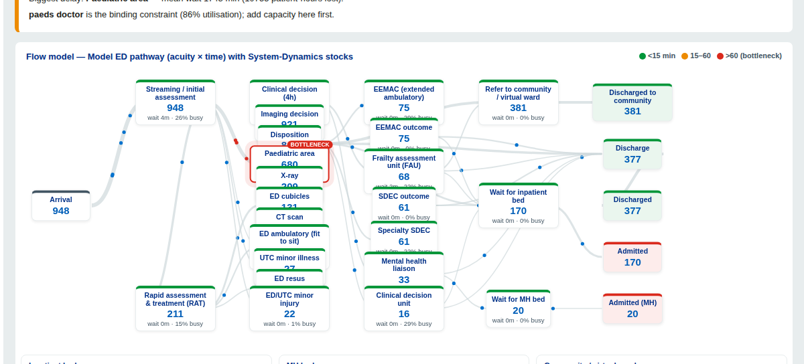

# NHS UEC Winter Demand & Capacity Planner

A planning tool for NHS Urgent & Emergency Care. It forecasts demand and answers, in
plain operational language (no modelling jargon), what to do — for **any** emergency
department. Two modes:

- **Plan for this winter** (ICB / investment): forecast winter demand from three
  numbers *or from your own uploaded attendance history* (it reads off the recent
  level, year-on-year growth and how much higher winter runs), then *what winter
  looks like*, *what's driving the pressure*, and *which investment option is worth
  it* — ranked by impact with an indicative cost band and a recommendation.
- **Today / this week** (operational): enter today's expected attendances and how
  full the hospital is, and get an **OPEL-style risk read**, the do-nothing
  projection, and the **no-cost actions** that help most right now (discharge push,
  SDEC hours, staff flex, escalation, redirect, community) — ranked, with who owns
  each and a clear "do this first".

Open `/` for the planner.

Under the hood is a principled hybrid simulation engine (below); none of its
modelling vocabulary appears in the planner. Analysts can open the full technical
model at `/analyst`.

```bash
pip install -r requirements.txt
python -m uec_hybrid.app.server     # planner at http://127.0.0.1:5000  (analyst view at /analyst)
```

---

## The engine — System Dynamics + Discrete-Event Simulation

A principled, evidence-based model of NHS Urgent & Emergency Care that **couples a
patient-level Discrete-Event Simulation (DES) with a whole-system System-Dynamics
(SD) model**. It is grounded in two NHS design documents:

- **NHS England, "The Model Emergency Department: high-performing UEC pathways"
  (Feb 2026)** — the ED operational pathway, structured as **acuity × time**.
- **Sussex, "Urgent and Emergency Care Model" (Aug 2025)** — the whole-system
  context (navigation, community, downstream beds, mental health).

The DES assesses the impact of **resource-capacity limits and acuity prioritisation**
at the patient level; the SD layer models the **whole hospital the ED sits inside**
(inpatient beds, mental-health beds, community/virtual-ward capacity) with the
**feedback loops** that drive real ED behaviour. Uncertainty is explicit via
**Monte-Carlo**; changes are tested with **scenario and sensitivity analysis** against
a baseline; and the simulated pathway is **validated by process-map conformance**.



## Why a hybrid, and how the two solvers couple

A pure DES cannot represent the dominant cause of ED crowding — **exit-block**, where
a near-full hospital cannot accept admissions, so patients board in the ED. That is a
*system* behaviour: a stock (occupied inpatient beds) with feedback. The hybrid:

- **DES (patient level):** every patient flows through the Model ED pathway
  contending for limited spaces and clinicians, with **acuity priority queues**
  (sickest first), span-held beds, variable durations by acuity and time-of-day demand.
- **SD (whole system):** homeostatic stocks for inpatient beds, MH beds and community
  capacity. High bed occupancy raises a **bed-wait multiplier** that slows ED
  admissions (exit-block); community headroom **pulls** patients out and accelerates
  discharge.
- **Coupling:** a `CoSimulator` runs an **hourly zero-order-hold co-simulation** —
  each simulated hour the DES flows (admissions, diversions, ED census) are drained
  into the SD model, the SD integrates, and the new signals are published back for the
  DES to read. Zero-order hold + smooth, bounded feedback + first-order smoothing keep
  the loop stable (verified by a self-test).

**Verified behaviour:** with the bed feedback on, admitted length of stay rises from
~270 to ~595 minutes — exit-block *emerges from the bed stock*, not from a static fudge
factor. Turning feedback off recovers the naïve DES.

## What it produces

- **UEC scorecard** RAG-rated against Model ED / UEC Plan standards: 4-hour (toward
  95%), initial assessment ≤15 min, 12-hour waits, ambulance handover ≤45 min, MH
  liaison ≤1h, MH >24h, children's 4-hour, EEMAC conversion-to-admission, bed occupancy.
- **Flow model "Figure 1":** the whole pathway by acuity×time band with the SD stocks
  and feedback, the bottleneck highlighted, patients animated along the links.
- **System-Dynamics charts:** bed/MH occupancy, crowding and feedback signals over time.
- **Monte-Carlo** distributions with 95% confidence intervals.
- **Scenario comparison + tornado sensitivity** vs baseline.
- **Process-map validation:** conformance of the simulated event order to the intended
  Model ED graph (a clean pass validates faithfulness; injected errors are caught).
- **Population & determinants:** age, deprivation (IMD) and paediatric share drive
  demand and case-mix; **ECDS calibration seam** to replace synthetic data with real
  attendance extracts.

## Architecture

```
uec_hybrid/
├── des/         DES engine (priority queues, span beds, dynamic SD-coupled params,
│                band/time enforcement), distributions, pathway (+ schema validation)
├── sd/          stocks, model (homeostatic bed/MH/community stocks + integrator),
│                feedback (smooth bounded transfer functions + smoothing)
├── coupling/    system_state (held signals + accumulators, zero-order hold),
│                cosim (hourly master clock), adapters (channel map)
├── demand/      population (age/IMD/paediatric -> case-mix), ecds_seam (calibration)
├── pathways/    model_ed.json (faithful Model ED acuity×time pathway)
├── analysis/    metrics (KPIs -> standards, RAG scorecard, bottleneck), montecarlo,
│                scenarios (+ tornado sensitivity)
├── validation/  reference_map, conformance (process-map check), process_map (variants)
├── viz/         flow_model ("Figure 1" data), figures (Plotly), palette
├── app/         server (Flask), templates/dashboard.html, static (dashboard.js + Plotly)
└── tests/       run.py (engine, SD, coupling stability + mass-balance, conformance)
```

## Run it

```bash
pip install -r requirements.txt

python -m uec_hybrid.app.server      # dashboard at http://127.0.0.1:5000
python -m uec_hybrid.tests.run       # end-to-end checks

python - <<'PY'
from uec_hybrid import Pathway, run_cosim, kpis, uec_scorecard, conformance_check
p = Pathway.load("uec_hybrid/pathways/model_ed.json")
res = run_cosim(p, seed=0)                 # coupled SD+DES
print(uec_scorecard({**kpis(res,p)}))
print("pathway validated:", conformance_check(res,p)["passed"])
PY
```

## A note on data and faithfulness

The model ships on **synthetic** parameters. Structure is taken from the NHS design
documents; service-time distributions are modelled/expert-set and clearly flagged as
such (they are not identifiable from attendance data). Calibrate arrivals, case-mix,
cohort prevalence and admission rates from a real ECDS extract via the **Data &
calibration** tab. Validate against local data before any operational use. Colours
follow the official NHS identity palette.
