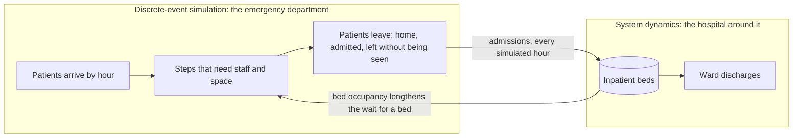
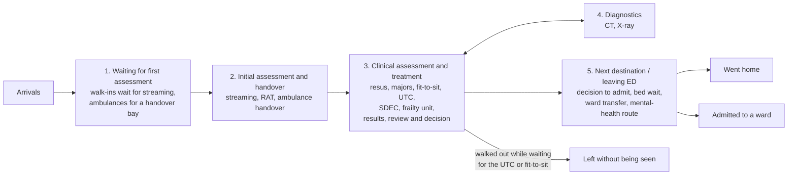

# Midshire ED Control Tower: the project from scratch

This document explains the whole project in one place: the problem it addresses,
what the tool is and is not, where its data comes from, how the model works,
the logic behind every feature, what it found, how it was checked, and what it
cannot yet do. It is written for anyone picking the project up for the first
time: an analyst, a developer, or an NHS colleague who wants to know what sits
behind the screens.

For the detailed engineering handover (file by file, test by test) see
[`docs/MIDSHIRE.md`](MIDSHIRE.md). For the source trust's data log see
[`docs/CUH_DATA_LOG.md`](CUH_DATA_LOG.md).

> **Status.** Midshire University Hospitals Trust is a **fictional** demonstration
> identity. The tool is a simulation and planning demonstrator, not a live
> patient feed, not a connected digital twin and not a clinically validated
> staffing tool. Its adult-only build has **not** been validated against a real
> adult-only department. Every figure on screen is a simulation output or a
> labelled input.

---

## Contents

1. [The problem](#1-the-problem)
2. [What the tool is, and what it is not](#2-what-the-tool-is-and-what-it-is-not)
3. [Where it comes from: the source model and the data](#3-where-it-comes-from-the-source-model-and-the-data)
4. [Methodology: how the model works](#4-methodology-how-the-model-works)
5. [How the numbers are made](#5-how-the-numbers-are-made)
6. [The logic behind each feature](#6-the-logic-behind-each-feature)
7. [Outputs: what the model shows](#7-outputs-what-the-model-shows)
8. [How it was checked](#8-how-it-was-checked)
9. [Limitations, and what would close them](#9-limitations-and-what-would-close-them)
10. [Running, reproducing and extending it](#10-running-reproducing-and-extending-it)
11. [How the project developed](#11-how-the-project-developed)
12. [Glossary](#12-glossary)

---

## 1. The problem

Emergency departments in England are judged on how quickly patients leave. The
headline standard is the share of attendances that leave the department
(discharged, admitted or transferred) within **4 hours of arriving**. Long stays
matter too: patients in the department for **more than 12 hours** are tracked
separately because they carry clinical risk.

Most departments fall well short of a 90% 4-hour level. The source trust behind
this model published **52.9%** for June 2026. Operational and planning teams are
asked the same questions again and again:

* **Where** do patients actually wait, and for what?
* **When** in the day does the department fall behind?
* **What would help**: more staff, more space, more beds, longer opening hours?
* **What would it cost**, in pay, building work and running costs?
* **What can we do with no extra budget?**
* **Will a change still help next week**, or did it only look good once?

Dashboards describe what happened; they cannot answer "what if". Trying changes
for real in a busy department is slow, expensive and risky, and one good week
proves little because no two weeks are the same. A simulation lets you replay
the **same** patients through a changed department and compare like with like,
as often as you need, before anything changes on the floor.

The brief for this build came from a design discussion with Joel and Richard:
show an **adult** emergency department as a simple left-to-right journey of no
more than five groups, start with overall performance before the detail, make
the data show where waits build up, and add a workforce and estates layer that
tells an investment story a stakeholder can follow. The demonstrator was
prepared for the South East Region show-and-tell on 16 October 2026.

## 2. What the tool is, and what it is not

**It is** a planning demonstrator with five pages:

| Page | The question it answers |
|---|---|
| Overview | How is the department doing, today or on a typical day, and where do waits build up? |
| Patient flow | How do patients move through the department, and where are they at any time of day? |
| Workforce & investment | What would it take to reach a target, what would it cost, and is the rota shaped like the demand? |
| Scenarios | What does each tested change do, and how do they compare? |
| Ask My ED | The same answers in plain sentences, plus "what if" questions |

**It is not**:

* a live feed. Nothing on screen is a real patient;
* a forecast. Results show direction and trade-offs, not next month's figures;
* a safe-staffing tool. Staffing ratios are illustrative planning values;
* proof that a target is impossible, or that a package is the cheapest possible.
  The search reports "the lowest-cost package found within the tested options".

## 3. Where it comes from: the source model and the data

### 3.1 The source model

Midshire is built on the **Cambridge University Hospitals (ODS code RGT)**
control tower in this repository: a hybrid simulation of an emergency
department calibrated to that trust's published figures and its own data
extracts. Midshire takes that model, changes what the brief asks for, and gives
it a fictional name. The Cambridge build itself is left untouched, and a test
checks that by hash.

### 3.2 The data, and the rule that nothing is invented

Every input traces to one of three places:

| Kind | Examples | Where it lives |
|---|---|---|
| **Published** (NHS England) | Attendances 400.5 a day and 4-hour 52.93% (monthly A&E return, June 2026); 1,068 general and acute beds at 89.26% occupancy (KH03, quarter to March 2026); ambulance handover (UEC SitRep) | `data/`, `uec_hybrid/data/rgt_published.json` |
| **Source trust extracts** | Arrivals by hour, acuity mix, area shares, CT and X-ray workload, mental-health admission rate (18.28%), SDEC time in department | `data/cuh/`, `rgt_published.json` |
| **Illustrative** (labelled) | The Midshire rota, staff costs, building costs, SDEC size, hours and streaming shares, space-staffing ratios, service times | `uec_hybrid/data/midshire/midshire_demo.json`, the seed workbook's `Status` tab |

Two conventions keep the claims honest: an explicit **0** in a capacity means
"we don't have this" and is kept, while a **blank** means "keep the template
estimate"; and a cost left **blank is "not costed"**, never £0.

### 3.3 Making it adult-only

The brief asked for adults only. Children are **removed from demand**, not
re-routed into adult areas:

```
400.5 attendances a day x (1 - 0.1335 paediatric-area share) = 347.0 adult attendances a day
```

The paediatric area, its staff, its routes and its metrics are removed with
them. The area-based share (13.35%) is used rather than the published age-based
share (19.7%) because the model routes patients by area.

### 3.4 What else changed from the source model

* **SDEC** (Same Day Emergency Care) is reachable from streaming and from RAT,
  with 12 chairs, open 08:00 to 22:00 (illustrative). Its care time was
  calibrated so the modelled SDEC time in department (247 minutes median)
  matches the source trust's observed 247 minutes.
* **Admission** runs as decision to admit (a counted event, not a wait), then
  waiting for an inpatient bed (the patient still occupies their ED trolley),
  then transfer to the ward.
* **Mental health** patients follow a sub-route with the source trust's real
  admission rate (18.28%) instead of the source model's fallback of admitting
  all of them.

## 4. Methodology: how the model works

### 4.1 Two models working together

The model couples two simulation methods, each doing what it is good at:



* **Discrete-event simulation (DES)**, built on SimPy, models individual
  patients. Each patient arrives, is given an acuity and a route, and moves
  through steps that need staff and spaces. Queues are ordered by clinical
  priority, sickest first. A patient can hold a **space** (a cubicle, a trolley)
  across several steps while **clinicians** are needed only for parts of it, so
  space and staff are contended at the same time, as in a real department.
* **System dynamics (SD)** models the hospital as a stock of inpatient beds with
  a background inflow from every other source and discharges that rise with
  occupancy. ED admissions are added each simulated hour. When the hospital is
  fuller, the wait for a bed gets longer. This is how bed pressure feeds back
  into ED waits ("exit block").

### 4.2 The adult pathway

Patients move left to right through five groups. Diagnostics is a loop patients
go out to and come back from.



SDEC takes patients from streaming and from RAT (in set shares by acuity). When
SDEC is closed, or a patient has waited 90 minutes for it, they are redirected
to the ED area that matches their acuity, so no patient is lost. Patients
waiting for the UTC or a fit-to-sit space can give up and leave (a waiting
patience averaging 3 hours); they are counted as left without being seen.

### 4.3 Demand

* Arrivals vary **by hour of day**, using the source trust's hourly profile
  scaled to 347 adult attendances a day. Each arrival belongs to a stream
  (ambulance, walk-in, GP referral, NHS 111) whose share changes through the day,
  and each stream has its own acuity mix.
* Demand does **not** vary by day of week: every modelled day has the same
  expected number of patients. Differences between days are chance, plus the
  weekday and weekend rota (see [section 9](#9-limitations-and-what-would-close-them)).

### 4.4 Capacity and staffing

* **Spaces**: 34 majors cubicles, 6 resus bays, 17 fit-to-sit spaces, 15 UTC
  rooms, 12 SDEC chairs, 3 ambulance handover bays, 3 CT scanners, 3 X-ray rooms,
  15 frailty unit beds.
* **Rota**: an illustrative rota of 31 shift rows (consultants, registrars,
  junior doctors, RAT, streaming nurses, Band 5 and 6 nurses, resus nurses, UTC
  practitioners, SDEC doctors and nurses, frailty practitioners, porters,
  healthcare assistants, receptionists), with day patterns, overnight shifts and
  unpaid breaks. The engine runs a 168-hour week, so weekday and weekend rotas
  differ where the rota says so.
* **A space needs staff to open.** Each space type has a planning ratio (one ED
  nurse opens four cubicles, one resus nurse two resus bays, one UTC clinician
  three rooms, one SDEC nurse four chairs). The number of spaces open in any
  hour is the smaller of the physical spaces and staff on shift times the ratio.
  Extra nurses cannot open cubicles that do not exist; extra cubicles stay shut
  without the nurses to open them.

### 4.5 How a run is designed

| Choice | Value | Why |
|---|---|---|
| Warm-up | 1 day (Monday) | The model starts empty; a real ED never is. The first day fills it and is not counted |
| Observed days | 6 (Tuesday to Sunday) | The patients whose results are reported |
| Drain | 12 hours | Lets patients who arrived on Sunday finish; anyone still in has missed the target and is counted that way |
| Weeks per run | 6 (seeds 101 to 106) | Enough to average out chance while keeping a run to minutes |
| Validation weeks | 8 (seeds 9001 to 9008) | A separate set, used only to re-test the best packages |

**Matched comparisons.** The baseline and every change run on the **same** six
weeks of random patients (the same arrivals, acuities and routes), so a
difference between them is the change, not luck. Results are summarised across
weeks as a mean, a range and a **simulation-noise interval** of the mean (a
t-interval). Differences between a change and the baseline are **paired** week
by week. These intervals describe noise in the model only; they are not
forecasts of real weeks.

## 5. How the numbers are made

Every number comes from **patient-level state intervals**: for each patient,
when they entered and left each step, split into "waiting" and "being seen or
tested". This single source, the **metric contract** in
`uec_hybrid/midshire/metrics.py`, feeds every page, the scenarios, the exports
and Ask My ED, so they cannot disagree.

| Measure | Definition |
|---|---|
| Left within 4 hours | Share of eligible adult attendances (everyone arriving in the observed days, no exclusions) who left within 4 hours of arriving. SDEC time counts inside the attendance. Anyone still present at the end counts as not met |
| Over 12 hours | Share in the department more than 12 hours, measured **from arrival** |
| Time in the department | Per patient; "typical patient" is the median, "1 in 10 take longer than" the 90th percentile |
| Time spent waiting | The union of each patient's waiting intervals, never a sum of stage averages |
| Where waits build up | Hours spent waiting at each step, added up across all patients |
| In the department, waiting | Counts at a moment; the groups add up exactly to the census |
| Patients moving between areas | Patients a day on each route; a box's moves in minus moves out equal its change in occupancy |

**Selected day and Typical day.** Every page can show either:

* **Selected day**: one modelled day (Tuesday to Sunday) of one simulated week,
  as it happened, every 15 minutes. Its 4-hour and other figures are for the
  patients who arrived that day, with the same definitions as the week; the days
  add up to the week. Monday is not offered because it is the warm-up day.
* **Typical day**: the average for each hour across every observed day of every
  simulated week (6 days x 6 weeks, 36 days). Its headline figures are the
  whole-run results.

## 6. The logic behind each feature

### 6.1 Overview

* A summary sentence that follows the view, the day and the time ("On Thursday
  362 patients arrived and 59.4% left within 4 hours, below the 90% target...").
* Five cards: patients in the department and waiting at the chosen time, the
  share leaving within 4 hours with its target and a status ("On target", "Close
  to target", "Below target"), arrivals and departures in the hour, and the
  typical patient's time in the department. A second row: over 12 hours,
  ambulance handover within 45 minutes, left without being seen, treated in
  SDEC, and either patients over 4 hours at that moment (Selected day) or
  decisions to admit a day (Typical day).
* Charts through the day (patients in the department and waiting; arrivals and
  departures by hour) and "Where waits build up".

### 6.2 Patient flow

* An animated **flow map** of the five groups, in the style of the Cambridge
  control tower: boxes show patients present, lines show patients a day moving
  between them, and moving dots show direction (paused under reduced motion).
* Selecting a group opens a **map of its areas** underneath; selecting an area
  shows its day, the staff and spaces serving it, and where its patients come
  from and go to. An expert view draws every modelled step.
* Diagnostics carries an honest caveat: the model gives the ED all CT and X-ray
  capacity, which the trust shares with inpatients, so imaging waits are a best
  case.

### 6.3 Workforce & investment

The page reads as a decision journey: **Now -> Target -> Changes -> Expected
-> Extra cost**.

**Set the target.** "90% of patients leave the department within 4 hours" is a
planning target the user can change (any percentage, any time in 15-minute
steps); nothing about 90% is hard-coded.

**Find the lowest-cost package.** The search, in `optimise.py`:

1. Runs the baseline on the selection weeks. If the target is already met, it
   says so and stops.
2. Tests every allowed change on its own, as a full re-run.
3. Builds packages step by step along two paths, re-running the full model for
   every candidate (effects are never added up arithmetically): "largest effect"
   and "best value per pound".
4. Prunes any package that meets the target: a change is dropped if the target
   is still met without it.
5. Ranks packages that meet the target and keep the guardrails (walk-outs and
   unfinished patients not materially worse) by **annualised comparison cost**:
   running cost a year plus one-off cost spread over 15 years. Partially costed
   packages are listed but never ranked as cheapest.
6. Re-runs the shortlist on the **separate validation weeks**, so choosing a
   package is never mistaken for confirming it.

The outcome is one of: already on target; reaches the target (with the cheapest
package found); or the tested changes don't reach it (with the best package, the
gap, and what still holds performance back).

**What can change.** Four options limit the changes the search may use:

| Option | Changes it may use |
|---|---|
| No extra resources: move existing staff and change how we work | Five moves of existing shifts to later hours (same role, length, break and days, so paid hours do not change); two process changes, each an **assumed** 10%: faster ward discharges, and quicker results, reviews and decisions |
| Staffing only | Ten extra-shift options (nurses, doctors, RAT, streaming, UTC, SDEC, porter) |
| Space and beds, with the staff they need | Extra cubicles, resus bays, UTC rooms, fit-to-sit spaces, SDEC chairs, a CT scanner, 20 inpatient beds, SDEC open until midnight, faster ward discharges; each space comes with the staff its ratio needs |
| Staffing, space and beds | All of the funded changes |

**Costs.** Pay comes from the rota through one cost service (basic rate,
on-costs, enhancements and any agency blend, all illustrative), as the
difference between the proposed and baseline rotas. Building and equipment
costs are unit cost times quantity. One-off and running costs are always shown
separately. A cost left blank is "not costed" and is listed as such.

**Try your own changes.** A rota editor (add, remove or change shifts, import or
export CSV), capacity, ratios, beds and costs, with an instant preview of pay,
spaces open and staffing, then "Run these changes" for the full simulation.

**Are we staffed for when patients arrive?** One panel per staff group for the
chosen day: staff on shift by hour, the shape of adult arrivals behind it, and
red bars where staffing looks **light against arrivals**. An hour is light when
its share of the day's arrivals is more than 1.2 percentage points above its
share of the day's staff (the shared heuristic from the workforce build). Areas
that close are compared only across their opening hours. This compares the
**shape** of the rota with the shape of arrivals; it does not say whether a
headcount is enough. Running the changes does that.

### 6.4 Scenarios

* The picker starts with the **Baseline** only. Other scenarios join it once
  opened, run or saved.
* Every scenario card says **what changes** (written from the scenario's own
  inputs, so it is right for searched, saved and hand-edited scenarios alike),
  **why test it**, **what to look for**, and its result on a typical day against
  the baseline.
* Ticked scenarios can be compared side by side with the baseline, and every
  scenario's inputs, rota and results can be downloaded.

### 6.5 Ask My ED

Ask My ED is another way into the same results, not a separate source of
numbers. It uses **no language model**: questions are matched to a small set of
intents and every figure in a reply is read from the stored result for the
scenario and view on screen.

| You ask | It does |
|---|---|
| "How are we doing?" | Describes the selected day or typical day with the same figures as the Overview |
| "Where do patients wait longest?" | The top stages from "Where waits build up" for that view |
| "What if we add 2 nurses 08:00-20:00?" | Turns the question into a checked change, runs it on the same weeks, and reports the effect. Nothing is saved |
| "What would it take to reach 90% within 4 hours?" | Runs (or reuses) the package search |
| "What could we do with no extra resources?" | Runs the no-extra-resources option |
| Anything else | Says plainly what it can answer |

### 6.6 How numbers are shown

The same kind of number looks the same on every page, in the scenarios and in
Ask My ED. A browser check compares the figures across all of them.

| Kind of number | Shown as | Example |
|---|---|---|
| Patients | Whole patients; a typical-day average below a half shows as "<1" | 52, <1 |
| Share of patients | One decimal | 66.5% |
| Change in a share | One decimal, signed, in points | +3.9 points |
| Time per patient | Whole minutes; "typical patient" and "1 in 10 take longer than" | 182 min |
| Patient time added up | Whole hours | 406 hours a day |
| Money | Whole pounds with commas | £152,000 |
| Times | 24-hour clock | 10:00 to 22:00 |

## 7. Outputs: what the model shows

All figures are simulation outputs of the fictional Midshire build.

### 7.1 The baseline (6 weeks)

| Measure | Mean | Range over 6 weeks |
|---|---|---|
| Left within 4 hours | 66.5% | 63.0 to 70.0% |
| Over 12 hours, from arrival | 10.0% | 9.2 to 12.0% |
| Typical time in the department | 182 min | 173 to 193 |
| Typical time spent waiting | 52 min | 43 to 67 |
| Left without being seen | 1.2% | 0.4 to 2.2% |
| Admitted | 17.9% | 16.5 to 18.9% |
| Treated in SDEC | 6.8% | 6.2 to 7.7% |
| Ambulance handover within 45 minutes | 94.7% | 90.5 to 98.2% |

**Where the waiting is.** The wait for an inpatient bed (about 406 patient-hours
a day) and waiting for results, review or a decision (about 286) dwarf every
other stage. The department is fullest from late afternoon to midnight.

### 7.2 What the changes do

| Search (target 90% within 4 hours) | Best package found | On the selection weeks | On the validation weeks | Cost |
|---|---|---|---|---|
| Staffing, space and beds | A CT scanner and four fit-to-sit spaces | 70.4% (+3.9 points) | +1.7 points, held up | £1,224,000 one-off + £152,000 a year |
| Staffing only | A senior RAT clinician 10:00 to 22:00 | 68.5% (+2.0) | -0.6, not confirmed | £300,501 a year (2.1 WTE) |
| Space and beds | 20 beds, a CT scanner, fit-to-sit, resus and UTC | 71.0% (+4.4) | +1.1, interval crosses zero | partially costed |
| No extra resources | Two registrars and RAT cover moved later, decisions 10% quicker (assumed) | 69.4% (+2.9) | -1.8, not confirmed | nothing extra; process change not costed |

A **70%** target is reached by the CT and fit-to-sit package, and it held up on
the validation weeks (70.3%).

### 7.3 What this means

* **No tested package reaches 90%.** The gap is about 19 to 22 points.
* **The constraint is bed flow and decision time, not where staff sit in the
  day.** No funded change shortens the bed wait or the time to a decision, and
  those two dominate the waiting.
* **Only one gain survives re-testing.** The CT and fit-to-sit package's +1.7
  points on separate weeks is real but small. The staffing-only and no-budget
  packages looked better on the weeks used to choose them and did not hold up.
* **No-budget changes help at the margins.** Moving existing staff gives up to
  about 2 points on its own, not reliably. Faster ward discharges are the
  no-budget change with the clearest effect: stays over 12 hours fall from 10.0%
  to 7.5%.
* **Rota shape.** Several groups, porters and resus nurses most of all, are
  staffed flat through the day while arrivals peak from late morning to evening.

### 7.4 Why Midshire scores higher than Cambridge

Measured on 16 matched weeks, step by step: the Cambridge source model, all ages,
52.6% -> adults within it 53.1% -> children removed from demand 58.9% -> the
Midshire pathway, rota and capacity 59.0% -> the real mental-health admission
rate 62.8% -> illustrative SDEC streaming 67.1%. Removing children frees shared
capacity (streaming, imaging, beds) for adults.

### 7.5 The Cambridge build after the shared fixes

| Measure | Model | Published |
|---|---|---|
| 4-hour | 55.3% | 52.9% |
| Over 12 hours | 11.0% | 10.0% |
| Handover within 45 minutes | 93.1% | 84.2% |

Per-area ratios against the trust's own figures: resus 1.11x, majors trolleys
0.94x, majors ambulant 0.88x, minors 1.00x, paediatrics 1.49x (outside tolerance,
as it was before this work).

## 8. How it was checked

**Acceptance checks** (`python3 -m uec_hybrid.tests.midshire`, also run inside
the full suite `python3 -m uec_hybrid.tests.run`):

| Check | What it proves |
|---|---|
| 1 | The build descends from the Cambridge base, and the protected Cambridge files and data are unchanged (by hash) |
| 2 | Exact product name and footer, Ask My ED, no technical wording or en dashes on the page, no Cambridge branding |
| 3a, 3b | No paediatric node, route, resource, rota row or demand anywhere |
| 4a | Both SDEC routes occur; SDEC takes no one while closed; outcomes are distinct |
| 5 | Decision to admit comes before the bed wait, transfer and departure |
| 6 | The census reconciles every 15 minutes; groups add to the census; the days add to the week; every flow-map box balances |
| 7 | Durations and waiting come from patient intervals (on a controlled three-patient case) |
| 9 | Rota rules: overnight shifts, day patterns, rejected values, blank is not zero, no floor of one |
| 10 | The engine, the editor and the costs use the same resolved rota |
| 10b | The staffing panels use the adult arrival curve and the shared heuristic; closed hours are never flagged |
| 11 | Cost-only edits move money, not performance; blank is "not costed", not £0 |
| 12/14 | Extra nurses cannot open cubicles that don't exist; added spaces get exactly the staff they need; no lost patients |
| 13/14 | The search handles met and not-reached targets honestly, re-runs every package in full, and uses separate validation weeks |
| 13c | The no-extra-resources option adds no hours, space or beds and labels its assumptions |
| 15 | Save, apply, reload, reset; the baseline is read-only; a result is only shown for the inputs that made it |
| 16 | Ask My ED quotes the stored results exactly, for a selected day and a typical day |
| 17 | Contrast, labels, focus states and reduced motion |
| 18, 18b | A fresh checkout starts from the committed results; runs finish on Windows and without worker processes |

**Browser checks** (`node docs/midshire/browser_check.js <url> <folder>`, run
locally with Playwright: 88 pass). They walk every page in the baseline and with
a scenario open, every day from Tuesday to Sunday at three times of day and the
typical day, compare the same figures across all features, and scan the visible
text for technical wording, at 1366x768, 1920x1080, a 390 px phone with reduced
motion, and 200% zoom.

**Validation against the source trust** (`python3 -m
uec_hybrid.validation.against_trust RGT`) is run after every change. The
repository's own rule is that passing tests do not mean the model is right:
every real defect in this build was found by comparing per-area figures with the
trust's, not by the test suite.

**Continuous integration** runs the end-to-end suite on every push to the pull
request.

## 9. Limitations, and what would close them

| Limitation | What it means | What would close it |
|---|---|---|
| Not validated for an adult-only department | Results show direction, not real performance | A real adult department's figures to compare against |
| No day-of-week demand | Differences between days are mainly chance; Monday is not shown | Attendances by weekday from the trust, and a run that starts on Sunday |
| Imaging is a best case | CT and X-ray are treated as ED-only; scan times are assumptions | The ED's share of imaging capacity and measured scan times |
| Decision time and bed wait are fixed durations | No funded change shortens them, which caps every package | Measured stage times and evidence of what shortens them |
| Process changes are assumed | "10% faster" is a what-if, not a measured effect | What would deliver it, and what it would cost |
| "Light against arrivals" compares shapes | It does not say whether a headcount is enough | Running the changes (already in the tool) |
| Pay averages unsocial-hours rates | Moving shifts into the evening may cost more in practice | Time-of-day pay rules in the cost table |
| One aggregate bed stock | No ward allocation or day-of-week discharge pattern | A ward-level bed model |
| Uncertainty is simulation noise only | Intervals are not forecasts of real weeks | Real week-to-week variation from trust data |

## 10. Running, reproducing and extending it

```bash
pip install -r requirements.txt
python3 -m uec_hybrid.midshire                       # http://127.0.0.1:5050
python3 -m uec_hybrid.midshire --check               # start, load results, report, exit
python3 -m uec_hybrid.midshire.precompute            # regenerate the stored results (about 15 to 20 minutes)
python3 -m uec_hybrid.midshire.validate              # pathway conformance and per-area comparison
python3 -m uec_hybrid.tests.run                      # the full test suite (must be green)
python3 -m uec_hybrid.validation.against_trust RGT   # the per-area comparison with the source trust
```

No external AI service, API key or network access is needed. Midshire keeps its
own database (`uec_midshire.sqlite3`, or `MIDSHIRE_DATABASE_URL`). To reset the
demo, use Scenarios -> "Back to the baseline", or delete the database file.

**Where things live:**

| Path | What it holds |
|---|---|
| `uec_hybrid/midshire/build.py` | The one build pipeline: adult cohort, SDEC, admission sequence, process changes |
| `uec_hybrid/midshire/metrics.py` | The metric contract |
| `uec_hybrid/midshire/runner.py` | Matched-seed runs, the replayed day, the typical day, worker processes |
| `uec_hybrid/midshire/optimise.py` | The package search and its wording |
| `uec_hybrid/midshire/packages.py` | Changes, staffing needed for spaces, costs, plain-language descriptions |
| `uec_hybrid/midshire/assistant.py` | Ask My ED |
| `uec_hybrid/midshire/server.py` | The web API and page |
| `uec_hybrid/data/midshire/midshire_demo.json` | Every Midshire input, change and label, each sourced or labelled |
| `uec_hybrid/data/midshire/precomputed/` | Stored results the demo opens on |
| `uec_hybrid/app/static/midshire.js`, `midshire.css`, `templates/midshire.html` | The screens |
| `uec_hybrid/des/`, `uec_hybrid/sd/`, `uec_hybrid/workforce/` | The shared engine, bed model and workforce code |

**Adding a change to the search:** add a lever to `search.levers` in
`midshire_demo.json` (its kind, size and title), add its plain-language name,
change, reason and what to look for to `lever_text`, and, for a new kind of
change, teach `packages.apply_lever` and `describe_changes` what it does. A
search's stored results only depend on the changes its own option may use, so
adding one does not invalidate the others. Then run the precompute and the
checks.

## 11. How the project developed

| Step | What was done |
|---|---|
| 1 | Built the Midshire adult demonstrator on the Cambridge model: adult cohort, SDEC routes, the admission sequence, the metric contract, the rota and cost editors, the package search, scenarios and the assistant, with shared engine fixes |
| 2 | Rebuilt Patient flow as Cambridge-style animated flow maps at group, area and step level, following the design discussion |
| 3 | Rewrote the tool for a non-technical NHS audience: plain language, Selected day and Typical day, consistent cards, a decision journey for investment, scenario cards that explain themselves; fixed the Windows "forkserver" crash at its root |
| 4 | Showed whole patients on the typical-day maps, clarified step tables, and added the imaging best-case caveat |
| 5 | Made every number read the same on every feature, made Ask My ED follow the view on screen, and added a cross-feature consistency check |
| 6 | Added the "No extra resources" option and reported honestly that its gain does not hold up |
| 7 | Added "Are we staffed for when patients arrive?" staffing panels on the workforce build's design |

## 12. Glossary

| Term | Meaning |
|---|---|
| 4-hour performance | Share of patients who leave the ED within 4 hours of arriving |
| Acuity | How urgent a patient is, 1 (most) to 5 (least); queues serve the sickest first |
| DTA | Decision to admit |
| DES | Discrete-event simulation: models individual patients and the resources they need |
| SD | System dynamics: models stocks and flows, here the hospital's beds |
| RAT | Rapid Assessment and Treatment: a senior clinician sees patients early |
| SDEC | Same Day Emergency Care: assessment and treatment the same day instead of admission |
| UTC | Urgent Treatment Centre, for minor illness and injury |
| Fit-to-sit | Majors patients well enough to be assessed in a chair |
| LWBS | Left without being seen |
| WTE | Whole-time equivalent: paid hours divided by a full-time contract |
| Warm-up, drain | The unreported day that fills the model, and the hours that let the last patients finish |
| Seeds, replications | The random streams that make each simulated week; the same seeds give matched comparisons |
| Selection and validation weeks | Weeks used to choose a package, and separate weeks used to check it |
| Annualised comparison cost | Running cost a year plus one-off cost spread over 15 years, used only to rank packages |
