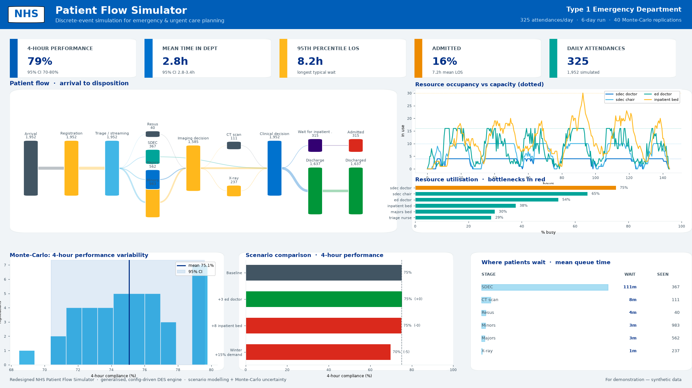

# NHS Patient Flow Simulator — redesigned DES tool

A generalised, decision-grade rebuild of the original DHSC Emergency Department
discrete-event simulation (the "beta tool"). It keeps the validated clinical
parameters but replaces the hard-coded, single-department engine and the
animation-only front end with a **config-driven engine**, **scenario modelling**,
**Monte-Carlo uncertainty**, and an **interactive analytics dashboard** designed
for client demonstrations and real capacity planning.



---

## Why it was redesigned

The beta tool was built for one hospital and could not support planning. Concretely:

| Limitation in the beta tool | How the redesign fixes it |
|---|---|
| Patient pathway **hard-coded** into ~2,000 lines of acuity-specific `if` branches; could not be adapted to another hospital without a rewrite | Pathways are **pure JSON** — a directed graph of nodes. Add or change a pathway with no code (see `pathways/*.json`) |
| Only an **Emergency Department** could be modelled | Same engine runs *any* flow — an ED **and** an Acute Medical Unit ship as examples |
| **Single run only**, no sense of variability (README's #1 priority: *"Explore variability… Monte-Carlo modelling"*) | First-class, parallelised **Monte-Carlo** with 95% confidence intervals on every KPI |
| **No scenario comparison**; outputs overwrote each other | **Scenario modelling**: declarative what-ifs (`+4 doctors`, `+8 beds`, `winter +15%`) compared side-by-side against baseline |
| Output was a 2-D **animation**, not analytics; no occupancy/utilisation/bottleneck reporting | **Decision dashboard**: KPI cards, patient-flow Sankey, occupancy-vs-capacity, utilisation, queue-wait bottlenecks |
| Beds modelled inconsistently; diagnostics had no machine queue | Resources can be **span-held** (a bed occupied across the whole episode) and diagnostics (CT/X-ray) contend for limited machines |
| Disabled levers (bed occupancy, exit block) | **Exit block is modelled** — admitted patients queue for a scarce inpatient/ward bed, the dominant NHS flow problem |

---

## Architecture

```
nhs_des/
├── engine.py        Generalised SimPy engine. A pathway is a graph of nodes
│                    (source / process / sink). Process nodes can transiently
│                    seize clinicians AND span-hold a bed; produce a tidy event
│                    log, patient log and resource-hold log.
├── metrics.py       KPIs, stage waits, utilisation, occupancy time-series,
│                    flow counts — all derived from the event log.
├── montecarlo.py    Parallel replication with confidence intervals.
├── scenarios.py     Declarative what-if modifiers + baseline comparison.
├── visualize.py     Interactive Plotly figures (Sankey, occupancy, …).
├── app.py           Flask dashboard (REST API + single-page UI).
├── snapshot.py      Renders the NHS-branded presentation image.
├── pathways/        emergency_department.json, acute_medical_unit.json
└── templates/       dashboard.html
```

### A pathway is just data

```json
{
  "id": "majors", "type": "process", "label": "Majors",
  "acquire": ["majors_bed"],        // bed held until a later node releases it
  "resource": "ed_doctor",          // clinician held for this stage only
  "service": {"dist": "lognormal", "mean": 90, "stdev": 35},
  "routes_by_class": { "Acuity 3": [["imaging_decision", 1.0]] }
}
```

Supported distributions: `constant`, `exponential`, `normal`, `uniform`,
`triangular`, `lognormal` (parameterised by real-world mean/stdev). Routing can be
global (`routes`) or per patient class (`routes_by_class`). A node can `stops_clock`
to freeze the 4-hour performance clock at transfer while still modelling bed turnover.

---

## Running it

```bash
pip install -r requirements.txt        # flask, plotly, simpy, numpy, pandas, matplotlib, scipy

# 1) Interactive dashboard
python -m nhs_des.app                   # http://127.0.0.1:5000

# 2) Presentation snapshot (PNG)
python -m nhs_des.snapshot nhs_des/pathways/emergency_department.json out.png

# 3) Programmatic use
python - <<'PY'
from nhs_des import Pathway, run_pathway, kpis, monte_carlo, compare_scenarios
p = Pathway.load("nhs_des/pathways/emergency_department.json")
print(kpis(run_pathway(p), p))
print(monte_carlo(p, replications=40)["summary"]["target_compliance"])
print(compare_scenarios(p, [{"name":"+3 SDEC doctors","resources":{"sdec_doctor":"+3"}}],
                        replications=8)["rows"])
PY
```

---

## What the demo shows (evidence-based planning)

Running the bundled ED (seeded from the original `config.json`, ~325 attendances/day):

* Baseline 4-hour performance ≈ **74%**, with the **SDEC clinicians** the binding
  bottleneck (≈ 80% utilisation, longest queue).
* Scenario **+3 SDEC doctors → ≈ 85%** 4-hour performance — the engine pinpoints
  *where* to invest.
* Scenario **+8 inpatient beds → no change** — correctly shows beds are *not* the
  ED constraint at baseline, preventing wasted investment.
* Scenario **winter +15% demand → ≈ 70%** — quantifies the surge risk.
* Monte-Carlo puts a **95% confidence interval** around each figure so a single
  lucky run is never mistaken for a plan.

The Acute Medical Unit pathway exhibits a *different* bottleneck profile
(AMU-bed access and exit block), demonstrating the tool generalises across the
diverse pathways found in NHS hospitals.

> Parameters are illustrative/synthetic and seeded from the beta `config.json`;
> validate against local data before operational use.
